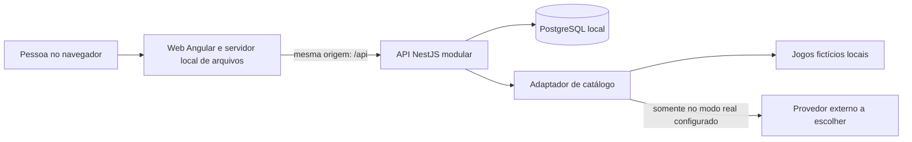

# ADR-001 — Organização e execução da aplicação
Versão: 0.1 | Estado: aprovada em DEC-026 | Data: 01/11/2026 | Base: DEC-023
Não autoriza implementação. Comparação: `../COMPARACAO-STACK.md` v0.1.

## Contexto e restrições aprovadas
Cinco áreas de requisitos do PRD v0.6, demonstração local persistente sem chave e integração real opcional. Dados públicos de perfil/biblioteca/avaliação e escritas com permissões distintas. Orçamento zero; um comando após preparo, sem comunidade compartilhada entre computadores.

## Alternativas
| Alternativa | Vantagem | Consequência |
| --- | --- | --- |
| API modular + SPA, mesmo repositório | Separação clara de tela, negócio e banco; PR completo por jornada | Dois builds e configuração da comunicação |
| Express servindo páginas e API num só processo | Menos peças operacionais e Express familiar | Adia ou muda a direção Angular e concentra mais decisões próprias de organização |
| Serviços independentes por domínio | Separação operacional mais forte | Múltiplos processos, comunicação e consistência distribuída para uma demonstração pequena; custo de aprendizado sem requisito correspondente |
| Repositórios separados para web/API | Ciclos independentes | Duplica preparação/coordenação do fluxo para um único autor; não melhora o requisito de baixar e experimentar facilmente |

## Recomendação proposta
Monólito modular significa uma única API, com módulos internos por responsabilidade. Angular é uma SPA, aplicação que roda no navegador e consulta essa API por HTTP. SQL armazena o estado persistente. REST, estilo de API com recursos e operações HTTP, é proposto pela familiaridade e adequação às jornadas; GraphQL exigiria outra camada e não atende a necessidade adicional já identificada.



Propor um servidor de arquivos/proxy na imagem web para servir os arquivos Angular e encaminhar /api, mantendo uma origem no navegador. Implementação do servidor/proxy e portas locais serão especificadas na tarefa de empacotamento. Não ativar exposição pública ou abrir firewall por este ADR.

### Estrutura proposta, não criada
```text
apps/web/           aplicação Angular
apps/api/           API NestJS e acesso ao banco
e2e/                jornadas de navegador
docs/               especificações, decisões, tarefas e evidências
infra/              arquivos de execução local, quando autorizados
package.json        workspace npm privado; nenhum pacote publicado
package-lock.json   resolução única das dependências
```
Um repositório com dois pacotes é um monorepo simples; não se propõe Nx/Turborepo ou biblioteca compartilhada por antecipação. Não transmitir tipos do ORM ao frontend: contratos de entrada/saída são explícitos, e tipos TypeScript não validam dados recebidos sozinhos.

### Limites internos propostos
- Acesso/perfis: identidade, sessão e leitura pública do perfil mínimo.
- Catálogo: interface comum para fonte fictícia e fonte real; chave fica na API, fora do frontend e do Git.
- Biblioteca: inclusão/remoção, estado e favorito; consulta a titularidade.
- Avaliações/comentários: nota, autoria, exclusão e condição de biblioteca.
- Amizades/feed: ciclo de solicitações e leitura das avaliações dos amigos atuais, combinada com conteúdo editorial fictício.

Fluxo: controlador recebe/valida entrada, serviço aplica regras, acesso a dados executa consulta/transação. Não criar uma camada genérica para toda tabela; introduzir abstração onde existe variação real, como as fontes de catálogo.

### Dados e invariantes derivados do produto
| Informação | Restrição proposta para preservar o PRD |
| --- | --- |
| Usuário | Email normalizado único; nickname com comparação sensível à capitalização, incluindo no índice do banco |
| Jogo | Identidade interna e origem (demonstração ou provedor/id externo); evitar colisão e conversão automática |
| Entrada de biblioteca | Única por usuário/jogo; contém estado/favorito; remoção não exclui jogo ou avaliação |
| Avaliação | Única por usuário/jogo; ligada ao usuário e jogo, não dependente da existência da entrada de biblioteca |
| Comentário | Vinculado à avaliação e autor; exclusão da avaliação remove comentários, conforme PRD |
| Solicitação/amizade | Um estado coerente por par de pessoas; restringir duplicatas e proteger aceite/cancelamento |
| Feed | Consulta de avaliações pelas amizades atuais + conteúdo editorial, em ordem de criação; edição não cria evento |

Propor nota como inteiro de 0 a 10 meios-pontos na persistência e converter para 0–5 na apresentação. É representação técnica para evitar fração imprecisa, sem mudar a escala aprovada. Validar condição de biblioteca e escrita em transação, evitando que requisições simultâneas criem duplicatas ou burlem a regra. Modelo e migrations serão revisados em tarefa própria; nenhum SQL executado nesta etapa.

Não propor tabela de eventos, fila ou atualização em tempo real para o feed inicial. Ler na abertura/atualização da página atende à fronteira proposta; caso se deseje atualização automática, isso precisa de revisão do comportamento antes do código.

### Demonstração e execução
Propor Compose com três serviços (web, API, banco) e volume persistente. Preparar banco/dados iniciais ausentes sem sobrescrever alterações de usuários; dados fictícios identificados, sem baixar jogos/imagens reais para o pacote. Aplicação preparada não depende de CDN/fontes remotas para as funções centrais do modo demonstração.

Alternativa nativa permanece disponível se Docker/WSL não couberem na máquina. A troca para SQLite ou mudança de arquitetura não ocorre silenciosamente; seria nova decisão. Disponibilidade e requisitos do Docker ainda serão diagnosticados antes de instalação.

## Verificações exigidas após autorização
1. Build web/API com versões fixadas e configuração ESM coerente; workspace sem lockfiles concorrentes.
2. Integração PostgreSQL cobre capitalização de nickname, unicidade, concorrência e preservação da avaliação.
3. Compose inicia e reinicia com persistência e dados de exemplo sem duplicação; modo demonstrativo preparado funciona sem provedor.
4. Escrita indevida falha na API mesmo se for chamada sem passar pelos botões do frontend.
5. Fonte externa testa falhas e ausência de credenciais sem apresentar dados fictícios como reais.

## Fontes e status
Capacidades de ferramentas nas fontes de `../COMPARACAO-STACK.md`; [Compose](https://docs.docker.com/compose/) descreve coordenação de serviços/redes/volumes. Organização e modelo acima são propostas de engenharia para os requisitos aprovados, não fatos observados numa aplicação existente. Nenhum build, contêiner ou teste de integração foi executado.

## Aprovação / substituição
Aprovada explicitamente pelo usuário em 01/11/2026, DEC-026. Conteúdo normativo preservado; termos proposta/recomendação acima descrevem a elaboração. Não substitui PRD ou DEC aprovada. Alteração material de comportamento exige revisão explícita do produto; aprovação do ADR não autoriza bootstrap da aplicação ou instalação por inferência.
